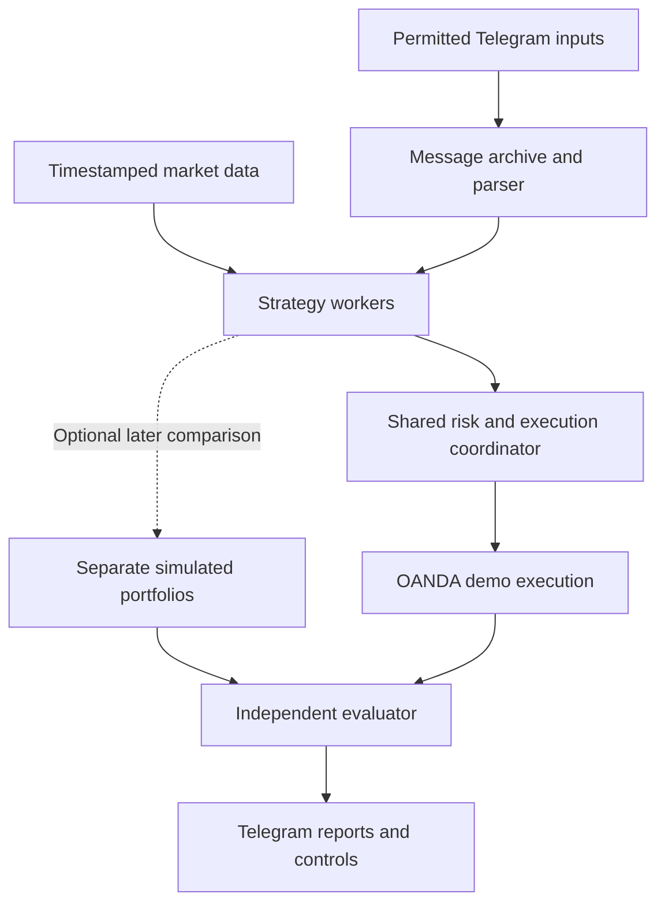

# Local strategy-agent lab and Telegram evidence

Date: 16 October 2026. Status: researched architecture proposal for discussion, not an approved implementation specification or a running system.

## User intent

Build a local workspace resembling an office of strategy specialists. Each agent owns one strategy, considers only EUR/USD and XAU/USD, makes autonomous trading decisions and receives an independent performance report. The user's example is ten specialists; the exact initial count has not been fixed. All broker execution begins on demo. Telegram provides the user interface; no frontend or VPS is needed to begin.

Updated direction: start directly with OANDA demo orders once the local connection and execution controls work. Separate simulated wallets are an optional research tool, not a prerequisite or a required first phase.

The user also wants to test whether messages from existing gold-focused Telegram groups improve predictions. They are a member who cannot add a bot, and posts mix explicit trade signals, commentary and chart images. No source access, message collection, source-use consent or account connection has been established.

## Recommendation: direct OANDA demo trading with one execution coordinator

The office metaphor maps well to a local service with isolated strategy workers and a shared clock/data feed. Each worker gets a versioned strategy definition, its own decision state, trade ledger, risk allowance, logs and results. Workers can operate concurrently without requiring separate virtual machines. Process or container isolation can be added for fault containment; it does not solve MT5 operating-system compatibility or create separate broker accounts. With one demo account, strategy budgets are allocations of shared capital, not independently funded wallets.

The trading policy should be reproducible. A worker can decide when to enter/exit within its assigned strategy; it cannot silently change the strategy, reset its losses or increase its budget during evaluation. Strategy changes become new registered versions. AI assistance can propose rules or interpret permitted unstructured inputs, while sizing, execution and loss limits remain explicit code.

All enabled workers may submit order intents to the coordinator. It checks strategy ownership, account mode, conflicting orders, combined risk and demo-account routing before submitting approved intents to OANDA. Broker-executed trades are visible in MT5 mobile. Record rejected intents and their reasons rather than counting them as executed trades. Optional simulated trades must remain separately labeled.

### Three execution arrangements

| Arrangement | What agents actually do | Trade-off |
|---|---|---|
| Separate local simulated portfolios, plus selected demo execution | Every agent trades its virtual account; shortlisted policies also place OANDA demo orders through the coordinator | Optional later research for independent counterfactual comparisons |
| Separate OANDA demo accounts | Each agent places broker demo orders into a different account | Cleaner broker-side isolation, but account availability, matching settings and terminal connections must be verified |
| All agents share one demo account | The coordinator combines or allocates all order intents under shared limits | Current starting recommendation; results must disclose shared capital, conflicts and allocation policy |

MT5 netting accounts allow one position per symbol, while hedging accounts allow multiple positions. We have not inspected the user's account mode. Query `ACCOUNT_MARGIN_MODE` and relevant permissions before implementing order allocation. Two opposing strategies can offset each other in a netting account; filtering a current position by an agent tag does not recreate independent books. [MetaQuotes account modes](https://www.mql5.com/en/book/automation/account/account_netting_hedge).

Balance, equity, free margin and stop-out thresholds are account-level properties. Thus separate tickets in a hedging account still share financial constraints. This is why one agent's loss or margin use can affect another. [MetaQuotes account properties](https://www.mql5.com/en/docs/constants/environment_state/accountinformation).

Use unique strategy/version identifiers plus order/deal records for attribution. MT5's `ORDER_MAGIC` identifies an Expert Advisor's orders; it is not an isolated wallet. Store explicit ownership, costs and allocation events internally. [Order properties](https://www.mql5.com/en/docs/constants/tradingconstants/orderproperties), [deal properties](https://www.mql5.com/en/docs/constants/tradingconstants/dealproperties).

Independent virtual results and the actual combined broker result answer different questions. Do not sum ten equal-sized virtual wallets and present that as the return of one account. Shared execution savings, rejected trades and priority decisions belong to the portfolio policy, not every individual strategy.

## How the FOREX.com guide fits

The linked article surveys trend, range, news, retracement, grid, carry and two time-based breakout-style approaches. It mixes broad families with more specific examples; it does not provide an OANDA EUR/USD–XAU/USD validation. Its timed examples require clarification of timezone and order semantics before coding. Fixed forex pip targets cannot be copied unchanged to gold. Treat this as a source of hypotheses. [FOREX.com strategy guide](https://www.forex.com/en/trading-guides/forex-trading-strategies/).

My proposed initial roster is four workers, with capacity to add ten or more after validation of the harness:

| Worker | Assigned hypothesis | Candidate horizon | What must be frozen before testing |
|---|---|---|---|
| Trend | Follow established direction | Daily, then a separately registered H4 variant | Trend definition, entry, exit, volatility lookback and stop |
| Breakout | Trade a confirmed break from a prior session range | M15 with optional H1 context | Session timezone, range interval, buffer, expiry and session exit |
| Pullback | Join an existing trend after a temporary retracement | H1/H4 | Trend rule, retracement depth, confirmation and invalidation |
| Range reversion | Trade back toward the center of a stable range | M15/H1 | Range detection using past data, entry boundary, stop and timeout |

These are proposed implementations, not claims of profitability. Trend and breakout remain the core baselines from the earlier research. Pullback and range are additional challengers motivated by the user's broader experiment. Each policy needs separate EUR/USD and XAU/USD results and instrument-specific execution settings. Reuse rule definitions where meaningful to limit overfitting; do not independently optimize every setting for every symbol.

Ten workers need ten well-defined experiments, not ten names for highly correlated versions of the same rule. Carry portfolios do not fit the selected two-instrument universe well. Defer event-time execution and grid variants until the execution coordinator handles their order and exposure behavior. A grid is not inherently martingale; any later grid experiment still needs explicit maximum inventory and loss limits. A fixed daily pip target is not a performance promise.

## Telegram access: feasible, with unresolved source rights

An ordinary bot receives messages from chats/channels where it participates, subject to group privacy settings. The user's membership does not grant the bot that membership. Since the user cannot add a bot, a normal bot token alone will not collect those group feeds. [Telegram Bot FAQ](https://core.telegram.org/bots/faq#what-messages-will-my-bot-get).

Technical options are a permissioned source feed, user-forwarded/exported content where reuse is permitted, or a user-authorized Telegram client accessing chats the user can already read. The client route requires its own application credentials and user login, not just a bot token. Access does not itself establish permission to reuse the content. No private chat collection or account login should be configured as part of this design discussion. [Telegram client application documentation](https://core.telegram.org/api/obtaining_api_id).

Telegram's published terms explicitly restrict using platform content for AI development, validation, benchmarking and deployment, and describe a limited exception involving explicit, informed, continuing consent from all relevant users for the specific content/context. Therefore being a member, paying for a channel, or being able to forward a message is not by itself sufficient for this proposed AI workflow. Resolve the permitted use with the source before ingestion; forwarding or exporting is not a workaround for these conditions. [Telegram content-licensing terms](https://telegram.org/tos/content-licensing), [API terms](https://core.telegram.org/api/terms).

The price-based lab can proceed independently. If source permission is unresolved, use synthetic/self-authored message fixtures to develop the ingestion interface and leave group-based evaluation disabled. Synthetic parser tests measure software behavior, not market edge.

## What the system would extract from permitted messages

Keep a source-specific record of the original observed content and each subsequently observed edit. Record source/message ID, publication timestamp, first-received timestamp, processing-complete timestamp, edit timestamp, attachments, links and parser version. Do not promise complete deletion history: API availability differs, and a later export may not contain removed posts or earlier versions. The Bot API exposes updates for known edited messages and channel posts, but its pending updates are not retained beyond 24 hours. [Telegram update documentation](https://core.telegram.org/bots/api#update), [delivery limits](https://core.telegram.org/bots/api#getting-updates).

Classify inputs into actionable trade signals, signal updates/cancellations, market commentary, retrospective results and unrelated content. A structured signal may include instrument, side, entry type/range, stop, targets, expiry and a reference to an earlier signal. Apply explicit rules for scaling out, moving a stop or closing a trade. Missing critical fields, unclear instrument or contradictory instructions should produce an untradeable record with a reason, not guessed prices.

Start with text signals. Chart interpretation requires a separate evaluated OCR/vision step, where permitted: chart timestamp, symbol, scale and the difference between an old marked-up chart and a current instruction matter. Low-confidence extraction should abstain. Commentary can become a separately defined context feature; it is not automatically an entry order. Parser confidence describes extraction reliability, not probability of a winning trade.

Treat all posts as untrusted market data. Embedded instructions cannot change system prompts, risk settings, account routing or access credentials. Deduplicate forwarded/cross-posted signals and avoid treating multiple groups copying one source as independent confirmation. XAU-only commentary must not silently become an EUR/USD signal.

## Test whether Telegram contributes anything

Use paired variants of the same frozen strategy:

- **A: market-data-only strategy.**
- **B: identical strategy with one precisely defined Telegram filter/context feature.**

For example, B may reject a candidate when a recent eligible source signal disagrees with its direction. The source lookback, missing-data behavior and conflict handling must be fixed in advance. A separate signal-following portfolio can evaluate explicit group calls if their terms, entries and exits are sufficiently clear; do not mix that portfolio with the strategy-filter comparison.

Compare A and B over the same calendar period, with the same starting capital, instrument universe, risk limits and cost model. Once a filter changes positions, later opportunities may differ: report both full portfolio outcomes and paired candidate-trade diagnostics. Keep missing, stale, rejected and unparseable inputs visible. Assess each source separately before testing a combination.

Availability is based on when the pipeline could act. A post published at 14:00 but first received at 14:02 cannot produce a 14:00 fill; parsing time also counts. Forwarded messages become available when received by the system. A revised stop observed after a loss cannot rewrite the original trade. Late exports without point-in-time versions are exploratory material, not clean forward-performance evidence. Screenshots saying a target was hit cannot replace independently replayed executable prices.

Do not select only profitable-looking posts or report a manually forwarded sample as the performance of an entire group. Preserve the selected source cohort and all eligible signals prospectively. AI models used in historical replay must not introduce knowledge of later outcomes; forward collection is the more defensible first test of unstructured inputs.

## How the office reports results

The evaluator consumes immutable decisions and independently computed fills, costs and marked-to-market equity. It does not trust an agent's explanation or a channel's claimed win rate as the result.

Report by strategy version, instrument, Telegram variant, source cohort and execution mode:

- Net return and expectancy after spreads, commission, slippage and financing.
- Maximum equity drawdown, tail losses and exposure, including open positions.
- Trade count, holding time, turnover, risk usage and unresolved data.
- Profit factor and win rate with sample size; undefined metrics remain undefined.
- Simulation-versus-demo execution differences and reasons the broker coordinator rejected a signal.
- Uncertainty and results across chronological test windows, not just a single winning week.

Ten strategies and their variants create a selection problem. Freeze rules during a comparison, retain failed trials, use time-based validation and a final untouched period, and require a forward follow-up before promoting the apparent winner. Do not automatically allocate more risk to yesterday's best performer. [Backtest-overfitting research](https://www.davidhbailey.com/dhbpapers/backtest-prob.pdf).

Telegram can expose `/agents`, `/leaderboard`, `/agent <name>`, `/sources`, `/status` and `/pause`. Reports must label independent simulated portfolios separately from executed OANDA demo results. These are proposed commands, not currently available functions.

## Next design decisions

Choose the initial roster, confirm intended capital/account currency and shared risk budget, and determine whether any Telegram source grants the required use permissions. Direct OANDA demo execution is the starting direction; independent simulation is optional. No credentials are needed for this discussion. Verify a local MT5 connection and demo-account mode before any broker orders; the execution adapter should refuse live-account routing during this demo phase. Record actual account-mode constraints and define conflict handling before enabling concurrent workers.

No new strategy implementation, Telegram ingestion, broker connection or backtest was performed in this research task.
